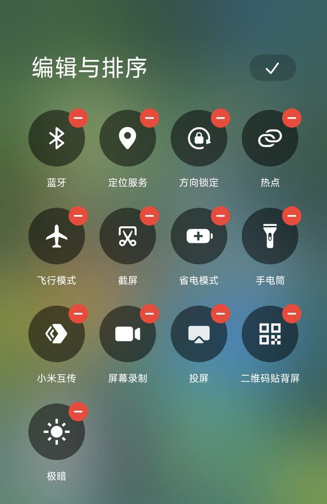
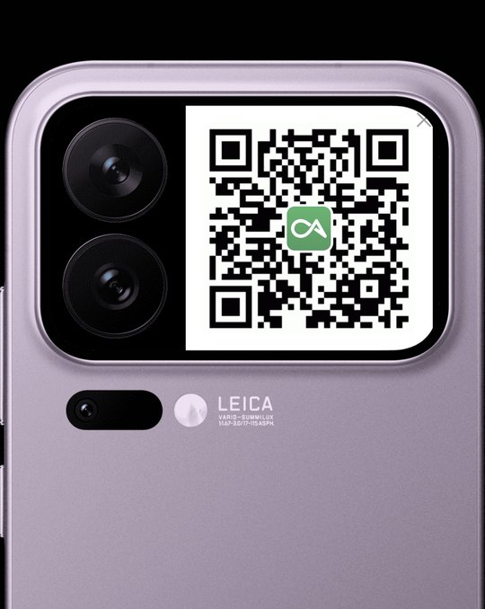
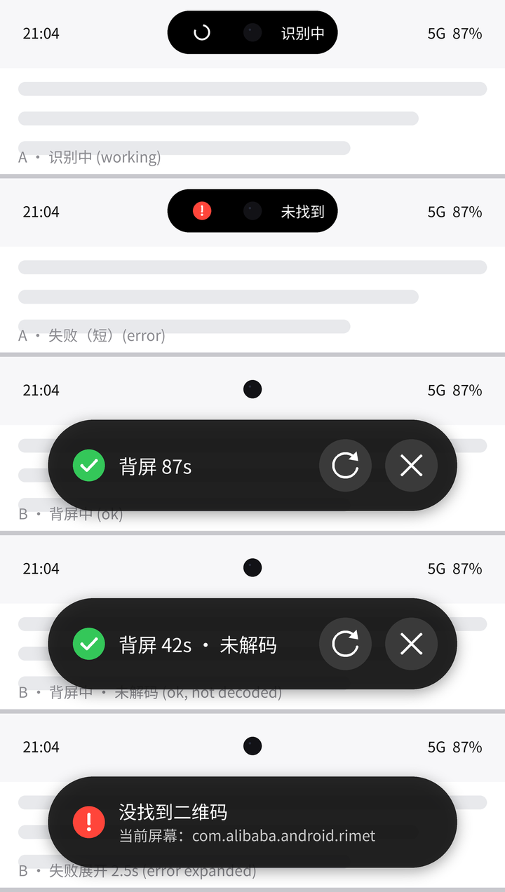

# 二维码贴背屏（com.hhy.rearqr）v0.1.12

把**主屏当前显示的二维码**截下来，裁剪放大后显示到**小米 17 Pro 背屏**上，方便把手机背面对着扫码枪 / 闸机。
适用于任何 App（钉钉、微信、支付宝付款码页面等都只是"屏幕上的图"）。本版**不解码、不重新生成**：只定位二维码位置，
裁剪原始像素，四周补白边后放大显示。

## 效果截图

<table>
  <tr>
    <td align="center"></td>
    <td align="center"></td>
    <td align="center"></td>
  </tr>
  <tr>
    <td align="center">控制中心「编辑与排序」里的<br>「二维码贴背屏」快捷开关</td>
    <td align="center">贴上后主屏的状态卡片：<br>✓ 背屏中 ｜ ⟳ 刷新 ｜ ✕ 关闭</td>
    <td align="center">二维码放大显示在背屏上<br>（避开摄像头区域）</td>
  </tr>
</table>

## 快速上手
1. 从 [Releases](https://github.com/huanghaiyangyy/rear-qr/releases) 下载最新的 `rear-qr-v*.apk` 并安装（需要已 root：KernelSU / Magisk）。
2. 打开「二维码贴背屏」，在 KernelSU 管理器 →「超级用户」里给它**授权 root**；回到设置页，状态显示「root：正常」即可。
3. 下拉控制中心 → 右上角**编辑** → 在「编辑与排序」里把「二维码贴背屏」加入快捷开关（见上图左）。
4. （可选）设置页点「打开省电策略设置」，把省电策略设为**无限制**；状态行会显示「小米省电策略：无限制 ✓」。
5. 打开任意二维码页面（付款码、名片、考勤码…），下拉控制中心点一下快捷开关：二维码就贴到背屏上了。
   背屏上单击 = 重新识别，长按或 ✕ = 关闭；默认 90 秒自动关闭。

## 胶囊设计

主屏上用一个仿澎湃OS「灵动岛」的悬浮胶囊代替 Toast 提示（设计稿见下图）：

- **识别中 / 失败**：纯黑小岛**包住前置摄像头挖孔**（以挖孔为中心、挖孔处留空），左边是状态图标（转圈 / 红色 !），
  右边是短文字（「识别中」/「未找到」…）；失败时会短暂展开成卡片显示完整原因，约 2.5 秒后收回；
- **贴上后**：从挖孔处向下、向两侧展开成状态栏下方的**宽卡片**：绿色 ✓ +「背屏 87s」倒计时（与背屏自动关闭同步，
  刷新后重新计时；未能解码时附「· 未解码」），右侧两个**一键圆形按钮** ⟳ 刷新 / ✕ 关闭，不需要先点开；
- **背屏关闭时**（超时、✕、长按、在背屏上划走…）：卡片**缩回摄像头孔消失**，背屏页和内存里的截图一并清理；
- **截图时自动隐藏**：每次 screencap 前隐藏、截完恢复，胶囊永远不会出现在截图里，也不影响识别；
- 不抢焦点；只有贴上后的卡片可点，其它状态完全不拦截触摸。

<p align="center">
  <br>
  <br>
  <sub>设计稿：识别中、失败（小岛）→ 贴上后（卡片）、未解码、失败展开；下：刷新 / 关闭按钮细节</sub>
</p>

## 工作原理
1. 触发后先收起通知栏 / 控制中心（`cmd statusbar collapse`），并检查主屏焦点窗口，确认它们已经消失（最多等 1.2 秒）；
2. 通过常驻的 `su` shell 执行 `screencap -d <主屏ID>`，原始像素直接读进内存（**不写任何文件**），截图用完立即丢弃；
3. 用 ZXing 3.5.4 找出画面里所有二维码（全分辨率 / 半分辨率 × 两种二值化；都解不出时只靠三个定位角也能定位），取**最大**的一个；
4. 按定位点算出二维码边界，四周加 12% 白边，放到背屏（自动识别背屏 display，找不到用 1），
   在避开左侧摄像头区域（296px）的范围内尽量放大、最近邻缩放（不模糊），亮度拉满、常亮。
   背屏显示方式（HyperOS 不允许直接在背屏启动第三方页面，`am start --display 1` 返回错误 102）：
   先用 root 在**主屏**启动一个完全透明、不拦截触摸的页面（独立任务），再用 root `am display move-stack <任务ID> 1`
   把它整个移到背屏，到背屏后才显示二维码；主屏上原来的 App 保持在前台。
   若移动失败，依次尝试 Presentation 和背屏悬浮窗（悬浮窗权限由 root 自动授予）。

## 安装
1. 从 [Releases](https://github.com/huanghaiyangyy/rear-qr/releases) 下载并安装最新的 `rear-qr-v*.apk`（需要 root：KernelSU / Magisk）。
2. 打开「二维码贴背屏」，KernelSU 会提示授权：打开 **KernelSU 管理器 →「超级用户」→ 找到「二维码贴背屏」→ 允许**。
   回到本应用，状态栏显示「root：正常」即可（点状态文字可重新检测；此时也会自动授予悬浮窗权限）。

## 触发方式
触发时**主屏上必须正显示着二维码页面**，所以只保留"不离开当前 App"的方式：
- **控制中心快捷开关**「二维码贴背屏」：下拉控制中心 → 编辑 → 把它加入。在二维码页面下拉、点一下即可
  （会自动收起控制中心再截图）。长按该开关打开设置页。
- **悬浮球 / 自动化工具**：能"启动 Activity / 发送 Intent"的工具都行：
  - Intent：Activity，action `com.hhy.rearqr.CAPTURE`（包名 `com.hhy.rearqr`，类 `com.hhy.rearqr.CaptureActivity`）；
  - root shell：`am start -n com.hhy.rearqr/.CaptureActivity`。
- **小米手势**：未在 HyperOS 4 / 17 Pro 上核实具体菜单。第三方文章称 HyperOS 的路径一般是
  「设置 → 更多设置 → 手势快捷方式」（名称因机型/版本而异）。注意：手势如果只能"打开应用"，会切到本应用的设置页、
  截到的是设置页，没用；只有能发送上面这个 Intent / 启动 CaptureActivity 的方式才行。

## 背屏上的操作
- **单击**：重新识别（重新截一次主屏并刷新）；
- **长按** 或右上角 **✕**：关闭，背屏回到原来的背屏桌面；
- 默认 90 秒后自动关闭（设置页可改，或打开「背屏页面常驻」）。

## 主屏状态「灵动岛」（v0.1.8 起替代 Toast；v0.1.10 仿澎湃OS 灵动岛）
- **识别中**：纯黑小胶囊**包住前置摄像头挖孔**（以挖孔为中心，挖孔处留空），左边转圈、右边「识别中」；
  **截图前自动隐藏、截完恢复**，不会出现在截图里；
- **成功**：从挖孔处向下、向两侧展开成状态栏下方的宽卡片（#E6111111，圆角 = 半高）：绿色 ✓「背屏 87s」（等宽数字，
  开了「背屏页面常驻」显示「背屏中」，未能解码时附「· 未解码」）+ 两个 46dp 圆形按钮 ⟳ 刷新 / ✕ 关闭，一次点击直接生效；
  倒计时与背屏计时同源，刷新后重新计时；
- **失败**：先是小胶囊（红色 ! | 未找到 / 无 root / 背屏失败），随即短暂展开成卡片显示完整原因，约 2.5 秒后收回挖孔并消失
  （若背屏页仍在，则回到成功卡片）；
- 背屏页因任何原因消失（超时、✕、长按、卡片「关闭」、在背屏上手势划走 >1 秒、页面被销毁）时，提示收回挖孔消失，
  背屏页彻底结束、内存中的截图清除，下次点开关从头走正常流程；
- 固定在摄像头位置（和系统灵动岛一样，不能拖动）；只有成功卡片可点，其余状态完全不拦截触摸；不抢焦点；
  没有挖孔信息时退到屏幕顶部中央（状态栏下方）；
- 悬浮窗权限由 root 自动授予；万一无法添加悬浮窗，才退回 Toast（logcat 有记录）。

## 主屏绝不显示二维码（v0.1.9）
背屏页在主屏上启动时完全透明、不可触摸、**不持有任何图片**；只有 root 移动后「窗口所在 display」「`am stack list`」
「窗口尺寸」三者都确认在背屏才显示二维码。移动失败就直接结束该页面（不再尝试 Presentation 回退）；
若之后被系统挪回主屏，立即隐藏并关闭。背屏悬浮窗回退只有在确认真的画在背屏上时才算成功（澎湃OS 通常拒绝）。

## 快捷开关在 App 被冻结时也能用（v0.1.11）
HyperOS（Greeze）会在 App 退到后台几秒后冻结它，以前点磁贴时 SystemUI 要先绑定服务再调用 onClick，冻结中就会丢失。
现在磁贴用 Android 14+ 的 `Tile.setActivityLaunchForClick()`：点击时由 **SystemUI 直接启动 CaptureActivity**
（同时收起控制中心），启动 Activity 本身会解冻进程，不再依赖 onClick，也不需要后台常驻服务。
每次 `onStartListening`（每次下拉控制中心）都会重新设置一次（SystemUI 重启后不会保留）。ROM 不支持时仍走原来的 onClick
（+ 1 秒内没启动就直接截图）。CaptureActivity 现在是完全透明、不可触摸、不抢焦点的页面，**一直保持到截图和背屏显示完成**
（最多 6 秒），期间 App 处于前台、不会被再次冻结。

设置页新增「小米省电策略：无限制 ✓ / 未设置」状态（root 读取 `settings get system MILLET_NO_RESTRICT_APP`，只读不写），
以及「打开省电策略设置」按钮（打开 HyperOS 的应用省电策略页，失败则打开应用信息页）。「后台常驻（备用）」：
磁贴偶尔没反应时再开，开启后常驻待命、耗电极低（默认关）。

## 设置页
自动关闭秒数、白边百分比、是否常驻、省电策略状态与设置入口、「5 秒后截取」按钮（点完 5 秒内切到二维码页面，到时振动一下并截图）、
状态（root / 背屏是否找到）。

## 找不到 / 出错时
- 主屏胶囊变红显示「没找到二维码（当前屏幕：包名）」并短振动，不会打开背屏页；
- 排查请用电脑或终端执行 `logcat -s RearQR`（记录了触发方式、焦点窗口、每条 root 命令的输出、用了哪种背屏显示方式）；
- 未授权 root 时提示去 KernelSU「超级用户」授权。

## 构建（无 Gradle）
`sh build.sh`（先跑 JVM 单元测试，再 aapt2 + javac + d8 + zipalign + apksigner），输出 `build/rear-qr.apk`。
需要 Android SDK（build-tools 37.0.0、platforms/android-36，路径可用 `SDK` / `BT` / `PLAT` 覆盖）和 JDK 17+。
ZXing core 3.5.4 来自 Maven Central，`libs/` 内附 sha1/md5/asc，构建时校验 sha1。

**签名密钥不在仓库里**（`keystore/`、`*.jks`、`password.txt` 都在 `.gitignore` 中）。首次构建先自己生成：
```sh
mkdir -p keystore
keytool -genkeypair -keystore keystore/rearqr.jks -alias rearqr -keyalg RSA -keysize 2048 -validity 10000
printf '%s' '你的密码' > keystore/password.txt
```
或用环境变量指定：`KS=/path/x.jks KS_ALIAS=别名 KS_PASS=env:变量名 sh build.sh`（`KS_PASS` 用 apksigner 的 `pass:` / `env:` / `file:` 写法）。
注意：用不同密钥签名的 APK 不能覆盖安装 Release 里的版本，需要先卸载。
